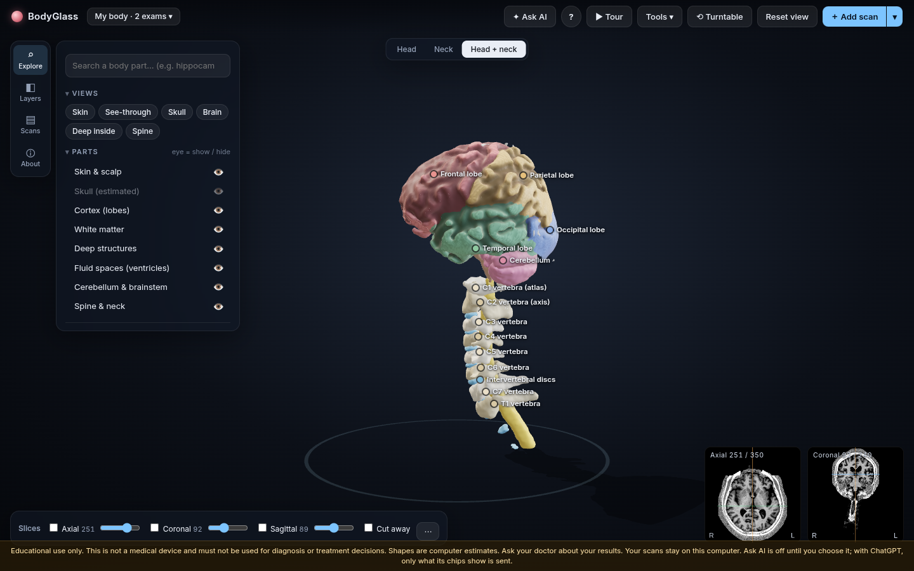
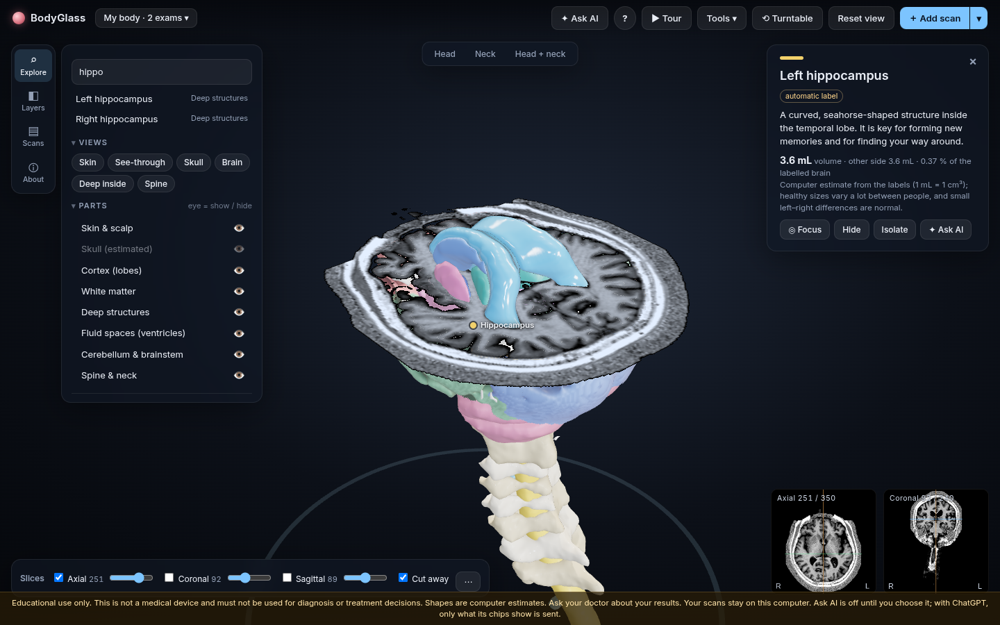

# BodyGlass

Explore your own head and neck MRI as an interactive 3D model, privately, on your Mac.



BodyGlass is a local macOS app for Apple Silicon. You give it the DICOM folder from an MRI exam, such as the
export your clinic or a patient portal gives you. It finds the right series, builds a 3D model of your head
(and, if you have one, your neck and cervical spine), and labels the structures in it: brain lobes and gyri,
deep structures such as the hippocampus and thalamus, the ventricles, cerebellum, brainstem, vertebrae, discs
and spinal cord. You can turn, peel, slice and measure the model, compare it with your other scans, and ask an
optional AI assistant what you are looking at.

> **Educational use only.** BodyGlass is not a medical device. It does not diagnose, screen for or monitor any
> condition, and it must not be used for treatment decisions. Its shapes, labels and volumes are automatic
> computer estimates and can be wrong. Ask your doctor about your results.

## Why it exists

Many people now get their own MRI images, but the usual tools for viewing them are built for radiologists:
flat grey slices, unfamiliar terms, and no sense of how the parts fit together in 3D. BodyGlass is meant to
help a curious person understand their own anatomy, in plain language, without uploading sensitive scans to
anyone else's server.

## What you can do

- **Add a whole exam folder.** BodyGlass reads the DICOM headers and sorts the series itself. The sharp 3D T1
  head scan becomes the 3D model; a sagittal neck or cervical-spine MRI is added as the neck. A plain-language
  list explains which series were used and why the others were not.
- **See a 3D model in about a minute**, with skin, an estimated skull, brain surface, white matter and
  ventricles. Detailed labelled structures follow a few minutes later while you explore.
- **Explore by part.** Search for any structure, show or hide groups, peel layers from the skin inward, make the
  skin see-through, or isolate one part. Click a part for a short plain-language description and a rough volume.
- **Slice through it.** Move axial, coronal and sagittal planes through the model, cut the model away at the
  slices, and colour the labelled structures on the slice pictures.
- **Use your other scans.** FLAIR, T2, SWI, DWI and ADC series from the same exam are aligned to the T1 and can be
  shown on the slices, compared side by side or with a swipe. An SWI scan can be traced into a 3D vein tree.
- **Measure, export and compare.** Measure distances in millimetres, export life-size STL or 3MF files for
  3D printing, and compare your model with an example brain from a public dataset of a healthy volunteer.
- **Move around easily.** Trackpad pinch, pan and rotate, double-click to orbit around a part, one-click Head,
  Neck and Head + neck views, a guided tour, and a ⌘K command palette.
- **Keep a library.** Models are saved automatically on your Mac and can be renamed, reopened or deleted.
- **Ask AI (optional, off by default).** Ask questions about what is on screen, a slice picture, a 3D snapshot or
  the text of your radiology report. Choose a private model that runs on your Mac (Qwen3.5, downloaded once) or
  your own ChatGPT Plus or Pro plan. The AI is told not to judge whether your scan is normal.



*Both images were made from a public research scan (Spine Generic dataset, subject amu01) with the skin hidden.*

## Privacy

- **Your scans never leave your Mac.** All processing runs locally. The app is a page served from
  `http://127.0.0.1:8765` that only your own Mac can open.
- The local server only answers requests addressed to `127.0.0.1` or `localhost` and refuses requests from other
  websites. The page's Content Security Policy blocks every outside address, and all JavaScript is bundled.
- **Network use is limited to:** the one-time setup (`install.sh`), AI model downloads you start, and ChatGPT if
  you choose it. With ChatGPT, BodyGlass asks before the first message and shows exactly what will be sent;
  nothing else is uploaded. There is no telemetry, and TotalSegmentator's usage statistics are switched off.
- Saved models, downloaded AI models and chats are stored in `~/Library/Application Support/BodyGlass`. A ChatGPT
  sign-in is stored in the macOS Keychain.

## Requirements

- A Mac with Apple Silicon (M1 or newer) running macOS 13 Ventura or later
- About 4 GB of free disk space (about 6 GB with the optional neck labelling), plus 3 to 6 GB for a private AI
  model if you use one
- Internet access once, for the setup
- Safari or Chrome
- No admin rights, Homebrew or system Python: everything is installed inside the BodyGlass folder

## Install

1. Download `BodyGlass-mac.zip`, unzip it, and move the `BodyGlass` folder somewhere permanent.
2. In Terminal, go into the folder and run the setup:
   ```bash
   cd /path/to/BodyGlass
   ./install.sh
   ```
   It installs a private Python 3.12 environment with PyTorch and downloads the model weights, checked with
   SHA-256. If it stops (for example, the Wi-Fi drops), run it again; finished steps are skipped.
3. Double-click `BodyGlass.command` to start the app. Your browser opens BodyGlass.

The app is not signed by Apple. If macOS refuses to open it, right-click `BodyGlass.command` and choose
**Open**. [INSTALL-MAC.md](INSTALL-MAC.md) has the full step-by-step guide, troubleshooting and uninstall steps.

## Update

1. Quit BodyGlass (close its Terminal window).
2. Unzip the new release somewhere else, for example in Downloads.
3. Copy it over your installed folder, then run the setup again:
   ```bash
   rsync -a ~/Downloads/BodyGlass/ /path/to/your/BodyGlass/
   cd /path/to/your/BodyGlass && ./install.sh
   ```
   Don't use Finder's "Replace", which would delete the installed environment. Your saved models, AI models and
   ChatGPT sign-in are kept.

## Quick start

1. Click **＋ Add scan** and choose the folder with your MRI exam (a whole export is fine).
2. Wait about a minute for the 3D model. A short banner tells you when the detailed structures are ready.
3. Drag to rotate, pinch to zoom, and swipe with two fingers to move. Double-click a part to orbit around it.
4. Use the left rail: **Explore** to find parts, **Layers** to peel and fade, **Scans** for your other scans.
5. Tick a plane in the slice bar at the bottom and turn on **Cut away** to look inside.
6. Press **?** for all shortcuts, or **▶ Tour** for a guided tour. No scan yet? Open the example volunteer from the
   welcome screen.

## How it works

BodyGlass is a small Python server and a browser-based 3D viewer, both running on your Mac.

1. **Series selection:** DICOM headers (never folder names) are scored to find the 3D T1, other scan types and
   the neck exam.
2. **Quick model:** the T1 is resampled to a 1 mm grid; SynthStrip outlines the brain; the skin, brain surface,
   white matter and ventricles are meshed.
3. **Labelled structures:** FastSurfer's segmentation network labels the brain (37 structure meshes, with
   31 cortical gyri per hemisphere named on click). TotalSegmentator labels the vertebrae C1 to T1, the discs and
   the spinal cord in the neck exam, which is then rigidly aligned to the head using the upper vertebrae seen in
   both exams. The alignment is refused, with an explanation, if it does not fit within 3 mm.
4. **Other scans** are aligned to the T1 with SimpleITK (rigid, mutual information).
5. **Viewer:** three.js renders the meshes and slice planes in WebGL2.

The local AI runs with MLX (`mlx-lm`, `mlx-vlm`) on Apple Silicon. ChatGPT is called from the local server using
Sign in with ChatGPT (OAuth with PKCE), never from the web page. See [ARCHITECTURE.md](ARCHITECTURE.md) for the
details, benchmarks and known limitations.

## Project layout

```
bodyglass/            Python package: pipeline, segmentation, neck, other scans, export, AI chat, local server
bodyglass/web/        the viewer (HTML, CSS, JavaScript; three.js bundled in vendor/)
tests/                pytest suite (public or synthetic data only)
tools/                developer scripts: test data builders, benchmarks, screenshots, release zip
design/               reference notes and UI mock-ups
docs/images/          README images
install.sh            one-time setup and updates
BodyGlass.command     double-click launcher
```

## Development

The pipeline, server and tests also run on Linux (CPU only):

```bash
./install.sh                                   # on Linux this installs the CPU-only build and the model weights
.tools/uv/uv pip install --python .venv/bin/python pytest
.venv/bin/python -m pytest tests
.venv/bin/python -m bodyglass /path/to/public/DICOM --no-browser --cases ./cases
```

The browser tests in `tests/test_ui_cutaway.py` need Playwright, Chrome and a processed public sample case;
otherwise they are skipped. `tools/make_dist.sh` builds the release zip.
GitHub Actions runs the suite on every pull request and push to `main` (`.github/workflows/tests.yml`), on Linux
without the browser tests and the local-model chat test, which need large downloads.

**Test data is public only.** Never add real patient scans, processed outputs, model weights or secrets to the
repository; `.gitignore` blocks the common file types. The scans used for development and the screenshots are:

- OpenNeuro [ds003097](https://openneuro.org/datasets/ds003097) (AOMIC-ID1000), CC0; also used as the in-app example brain
- OpenNeuro [ds000001](https://openneuro.org/datasets/ds000001), CC0
- OpenNeuro [ds000105](https://openneuro.org/datasets/ds000105), PDDL
- OpenNeuro [ds004146](https://openneuro.org/datasets/ds004146) (QTAB) and [ds000221](https://openneuro.org/datasets/ds000221) (MPI-Leipzig LEMON), CC0
- [Spine Generic multi-subject dataset](https://github.com/spine-generic/data-multi-subject) (OpenNeuro ds001919), subject amu01, defaced. Released under MIT on OpenNeuro and CC BY 4.0 in current releases. Cohen-Adad et al., *Scientific Data* 2021.
- [datalad/example-dicom-structural](https://github.com/datalad/example-dicom-structural) (studyforrest), PDDL
- Compressed multi-frame DICOM test files (JPEG and JPEG 2000) from [pydicom-data](https://github.com/pydicom/pydicom-data) (MIT),
  [pydicom's test files](https://github.com/pydicom/pydicom/tree/main/src/pydicom/data/test_files) (MIT) and
  [GDCM test data](https://github.com/malaterre/gdcmdata) (GDCM BSD-3-Clause); downloaded at pinned commits and checked by
  SHA-256 by `tools/fetch_compressed_samples.sh`, not stored in the repository
- [open-dicom/siemens_mprage_0](https://github.com/open-dicom/siemens_mprage_0), published as sample data without a stated licence

NIfTI scans were converted to DICOM with synthetic headers (`tools/nifti_to_dicom.py`, `tools/bids_to_dicom_study.py`).

See [CONTRIBUTING.md](CONTRIBUTING.md) and, for security issues, [SECURITY.md](SECURITY.md).

## Roadmap

Planned work and known issues are tracked in [GitHub issues](https://github.com/mcfazeli/bodyglass/issues) and on
the [project board](https://github.com/users/mcfazeli/projects/1). Current topics include testing on more Mac
hardware and better alignment of thick-slice scans.

## Credits and licenses

BodyGlass builds on the following open models and libraries. Each keeps its own license. Model weights are
downloaded by the setup or by the app, not stored in this repository.

| Component | Used for | License |
|---|---|---|
| [SynthStrip](https://synthstrip.io) weights (Hoopes et al., *NeuroImage* 2022) | Brain outline. BodyGlass contains its own PyTorch port of the network. | MIT or CC BY 4.0 (your choice) |
| [FastSurfer](https://github.com/Deep-MI/FastSurfer) v2.6.0, FastSurferVINN weights (Henschel et al., *NeuroImage* 2020 and 2022) | Brain structure labels (segmentation only) | Apache-2.0 (code and weights) |
| [TotalSegmentator](https://github.com/wasserth/TotalSegmentator) 2.18 (Wasserthal et al.), tasks `total_mr` and `vertebrae_mr` | Neck labels (optional) | Apache-2.0; these tasks need no license key |
| [three.js](https://threejs.org) r186 | 3D viewer (bundled in `bodyglass/web/vendor/three/`) | MIT |
| [Qwen3.5-4B / 9B](https://huggingface.co/Qwen) | Private AI assistant (optional download) | Apache-2.0 |
| [MedPsy-4B](https://huggingface.co/qvac/MedPsy-4B) | Optional medical-tuned text model | Apache-2.0 |
| [MLX](https://github.com/ml-explore/mlx), [mlx-lm](https://github.com/ml-explore/mlx-lm), [mlx-vlm](https://github.com/Blaizzy/mlx-vlm), [llama-cpp-python](https://github.com/abetlen/llama-cpp-python) | Running the private AI on the Mac | MIT |
| [PyTorch](https://pytorch.org), torchvision | Running SynthStrip, FastSurfer and TotalSegmentator | BSD-style |
| [pydicom](https://github.com/pydicom/pydicom), pylibjpeg, pylibjpeg-openjpeg | Reading DICOM | MIT |
| [pylibjpeg-libjpeg](https://github.com/pydicom/pylibjpeg-libjpeg) | Reading JPEG-compressed DICOM | GPL-3.0 |
| [SimpleITK](https://simpleitk.org) | Aligning scans | Apache-2.0 |
| NumPy, SciPy, scikit-image, pandas, h5py | Image processing | BSD-3-Clause |
| trimesh, fast-simplification, nibabel, keyring | Meshes, NIfTI, Keychain | MIT |
| requests, yacs | Downloads, FastSurfer config | Apache-2.0 |
| [uv](https://github.com/astral-sh/uv) | Private Python install | MIT or Apache-2.0 |

If you publish work that uses BodyGlass's structure labels, please cite the SynthStrip, FastSurfer and
TotalSegmentator papers.

BodyGlass is licensed under the [Apache License 2.0](LICENSE). See [NOTICE](NOTICE) for bundled third-party code.
